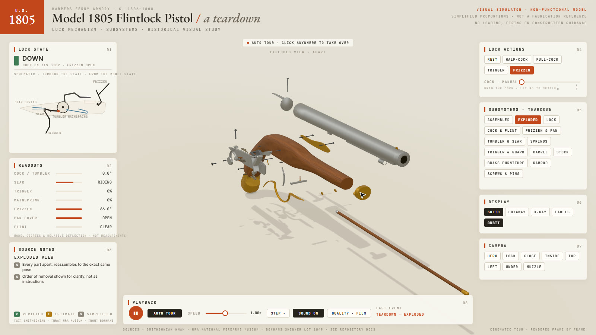

# Model 1805 Flintlock Teardown

**Live demo: <https://simsi2027.github.io/Flintlock-Teardown/>**
**Repository: <https://github.com/SimSI2027/Flintlock-Teardown>**

An interactive 3D teardown simulator of the **U.S. Model 1805 flintlock pistol** made at the national armory at
Harpers Ferry (1806–1808). One page shows the lock's resting, half-cock and full-cock states and how the trigger,
sear, tumbler, cock, frizzen and pan cover move together. Every subsystem has a button that takes it apart while the
rest of the pistol steps aside. Left alone, the page tours itself.



> **A historical visual study only.** The model is code-generated and permanently non-functional. Its proportions
> are simplified and are not the original's dimensions. It contains no manufacturing drawings, measurements,
> tolerances, material specifications, loading, firing or ammunition information, performance figures, or
> guidance for building, restoring, converting or operating a firearm. The teardown order is chosen for visual
> clarity and is not a disassembly procedure.

## What it shows

- **One authoritative state model** (`src/shared/lock.js`). The cock angle, frizzen angle and trigger travel are
  commanded by a deterministic planner. Every pose, every readout, the schematic and every sound event is derived
  from that one state. The sear's position comes from the tumbler's notch profile; the frizzen yields only where the
  flint actually meets its face.
- **Lock states:** rest (cock down on the closed frizzen), half-cock (sear in the hooked notch, so the trigger is
  blocked) and full-cock (sear on the step). Releasing from full-cock shows the sear clearing, the cock falling, the
  flint meeting the frizzen face and the frizzen thrown open to uncover the pan. The release is slowed so it can be
  followed.
- **Subsystem teardowns**, one button each: Lock, Cock & flint, Frizzen & pan, Tumbler & sear, Springs, Trigger &
  guard, Barrel, Stock, Brass furniture, Ramrod, Screws & pins. There are also Assembled and Exploded buttons.
  Fasteners come out before the parts they hold. Every teardown reassembles to exactly the same pose.
- **Display modes:** solid, cutaway (a window through the stock and lock plate), x-ray (glass stock, plate and side
  plate), callout labels and orbit.
- **Camera presets:** hero, lock, close, inside, top, left, under, muzzle. Drag to orbit, wheel to zoom.
- **Live console:** lock state, a schematic drawn from the model state, readouts in model degrees and relative
  deflection, and source notes tagged **V** (verified), **E** (estimate) and **S** (simplified).
- **Auto tour** with an on-screen pointer. Any click, drag, wheel or key hands control to you with the exact state
  on screen; after 25 s of quiet the pistol walks itself back to rest and the tour resumes.
- **Mechanical sound** synthesised in the browser and fired by the model's own events (notch clicks, stops, the
  flint on the frizzen, the frizzen's stops, teardown moves).
- **Manual controls:** pause, step, speed (0.1×–2×), and a slider that moves the cock by hand. Let go and it settles
  in the notch below.
- **Performance modes:** Auto (steps down while frames are slow), High, Balanced and Low for integrated graphics.
  Add `?quality=low` to start in the lightest mode.

### Keyboard

| Key | Action | Key | Action |
|---|---|---|---|
| R / H / F | rest / half-cock / full-cock | T | trigger |
| Z | frizzen open/close | S / C / X | solid / cutaway / x-ray |
| E / A | exploded / assembled | L / O | labels / orbit |
| 1–8 | camera presets | Space / . | pause / step |
| M | sound | | |

## Historical configuration

| | |
|---|---|
| Design | U.S. Model 1805 flintlock pistol, Harpers Ferry Armory, made 1806–1808, issued in identically numbered pairs |
| Verified features | walnut half-stock, key fastened; round barrel; iron rib with iron rammer pipe; flat lock plate with pointed tail; integral pan and fence; lock marked with an eagle over "US" and HARPERS / FERRY / date; brass butt cap with long ears, trigger guard with pointed finial, flat side plate, nose band, entry pipe; wood rammer with brass tip and iron ferrule |
| Estimated | the cock's gooseneck profile, frizzen and spring shapes, all internal lock parts' shapes and positions, the screws and pins |
| Simplified | all proportions (no measurements claimed); exterior-only barrel; empty pan, no ignition; stylised timing |

Sources: Smithsonian NMAH, the NRA National Firearms Museum, and a Bonhams Skinner (2025) catalogue description of
an 1807-dated example. The full source list and the verified, estimated and simplified breakdown are in
**[docs/HISTORY.md](docs/HISTORY.md)**.

## Build, test, record

Node.js 20+ is required; the video also needs `ffmpeg` and Python 3.

```sh
npm ci
npx playwright install chromium
npm run build              # dist/index.html (live) and dist/film.html (film), self-contained
npm run test:unit          # state model, channels, teardown, tour (node --test)
npx playwright test        # live page, every control, teardowns, collisions, deterministic film frames
```

Deterministic film (1920×1080, 60 fps, H.264, synchronised sound):

```sh
npm run build && npm run timeline
node scripts/capture.mjs film --size 1600x900 --dpr 1.2 --fps 60 --out out/film-silent.mp4
python tools/run_sfx.py score/score.py                     # out/score.wav, from src/film/timeline.json
ffmpeg -y -i out/film-silent.mp4 -i out/score.wav -map 0:v -map 1:a -c:v copy -c:a aac -b:a 256k -shortest -movflags +faststart out/flintlock-teardown.mp4
node scripts/sheet.mjs --video out/flintlock-teardown.mp4 --every 6 --cols 4   # read back what the encoder wrote
```

`npm run video` runs all of the above in one go (`scripts/video.mjs`), plus a contact sheet of the tour's beats
(`out/contact-sheet.png`, beats read from the timeline). A copy of the sheet is in `media/contact-sheet.jpg`.

## How it is built

| File | Job |
|---|---|
| `src/shared/lock.js` | The state model: 2D lock geometry in model units, contacts, notch profile, the planner, events. No three.js. |
| `src/shared/channels.js` | Deterministic channels for the teardown, display mode, camera and toggles; `createWorld()` combines them. |
| `src/shared/teardown.js` | Members and ordered moves for every subsystem button. |
| `src/shared/pistol.js`, `geo.js` | Every part generated from code: lofted stock, lathed barrel, swept and extruded parts. |
| `src/shared/stage.js` | Studio lighting, shadows, GTAO, and the solid, ghost, x-ray, cutaway and accent looks. |
| `src/shared/console.js`, `frame.js` | The 1600×900 console, schematic, readouts, callouts; one frame from one state. |
| `src/shared/tour.js`, `film.js` | The tour script; the film as a pure function of time. |
| `src/shared/live.js`, `audio.js` | The live page, takeover, quality tiers, WebAudio sound. |
| `src/shared/inspect.js` | Surface-voxel collision inspection used by the tests. |
| `score/score.py`, `tools/sfx` | The film's score on the timeline the model writes. |

The runtime, capture script and sound engine are adapted from the *teardown* kit, built on
[whaleyxbt/claude-motion](https://github.com/whaleyxbt/claude-motion) (MIT); see `tools/KIT-LICENSE.txt`. three.js
(MIT), Inter, JetBrains Mono and EB Garamond (SIL OFL) are bundled into the page.

## Licence

MIT for the code in this repository. The historical sources are cited, not reproduced.
